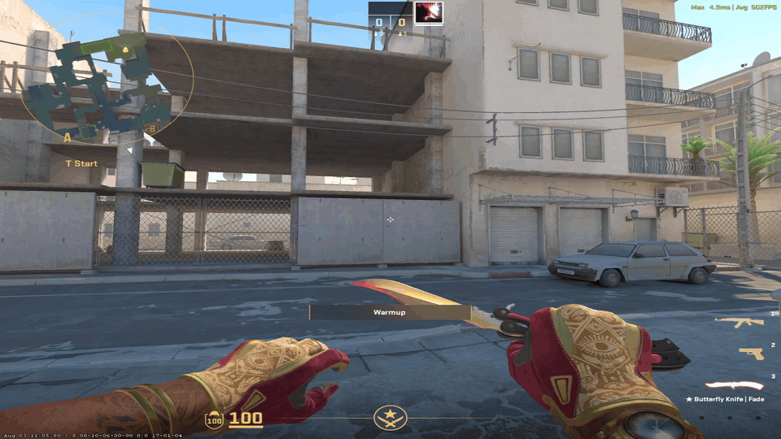
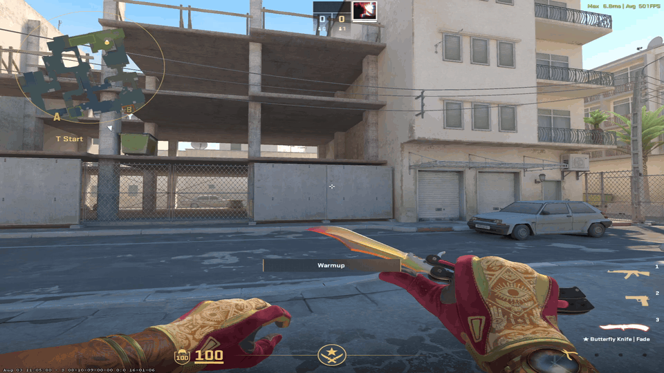
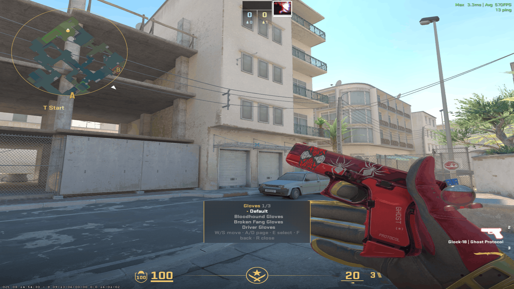
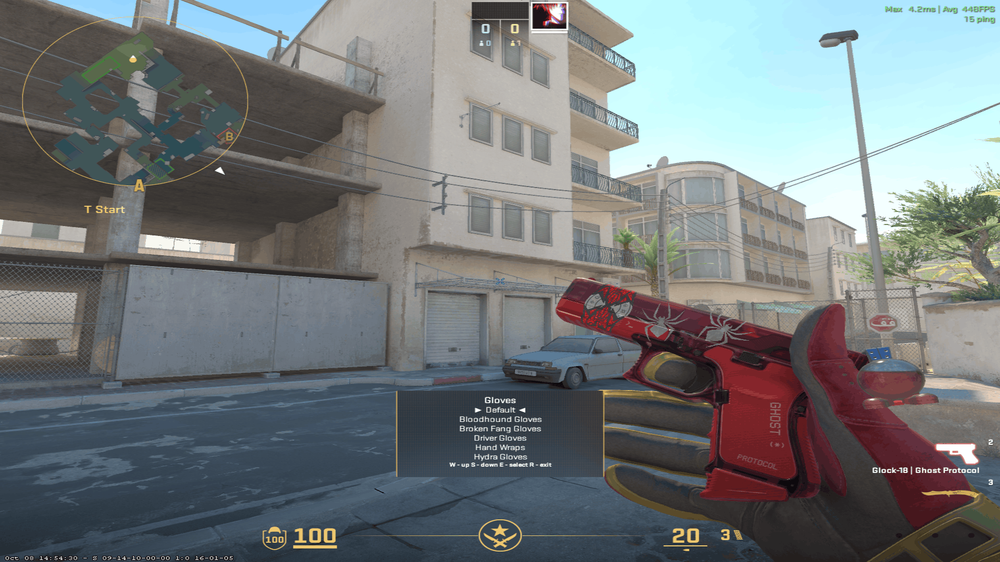
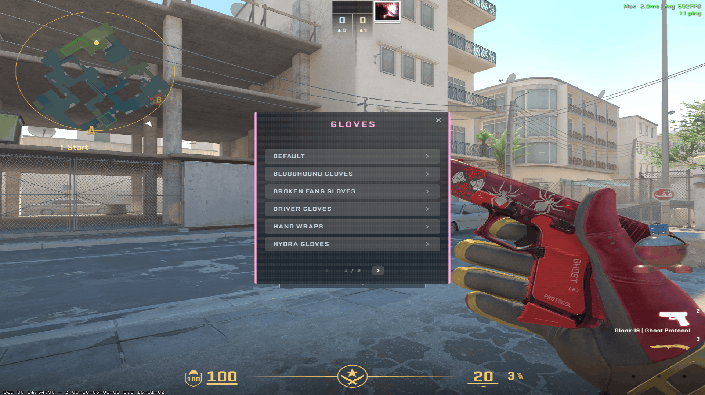
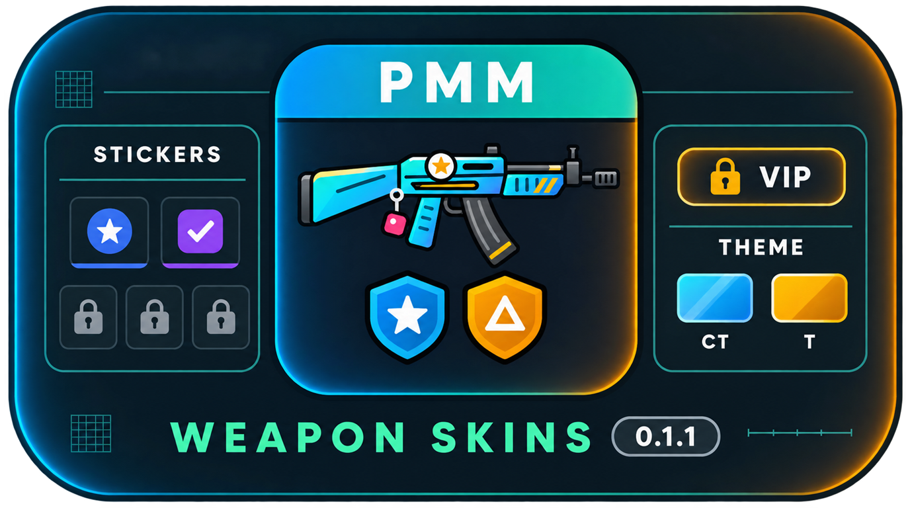

# WeaponSkins

WeaponSkins is a [CounterStrikeSharp](https://github.com/roflmuffin/CounterStrikeSharp) plugin for customizing CS2 loadouts. Each player’s CT and T selections are saved in MySQL.

## Features

- **Weapon skins:** Set wear (float), seed (pattern), name tags, and StatTrak.
- **Loadout:** Choose knives, gloves, agents, music kits, and profile pins.
- **Stickers:** Manage four slots per weapon. An optional, shared VIP restriction covers stickers and gen (off by default).
- **Custom crafts:** Apply up to five stickers using inspect codes from [CS2Inspects](https://cs2inspects.com/sticker-customizer), [CSFloat](https://csfloat.com/db), [Steam](https://steamcommunity.com/market/search?appid=730), or [CS2Preview](https://cs2preview.com/craft).
- **Automatic skin data updates** after CS2 updates.
- **Discord:** Manage skins with the built-in bot, or use Discord-Utilities for linking only.
- **Menus:** Built-in, MenuManagerCS2, or PanoramaMenuManagerCS2.

## Showcase

<table>
<tr>
<td width="50%" align="center">
<br>
<strong>Knives, Gloves &amp; Agents</strong>
</td>
<td width="50%" align="center">
<br>
<strong>Pins &amp; Music Kits</strong>
</td>
</tr>
<tr>
<td width="50%" align="center">
<br>
<strong>Skins &amp; Stickers</strong>
</td>
<td width="50%" align="center">
<br>
<strong>Custom Crafts (Gen)</strong>
</td>
</tr>
</table>

## Requirements

- **CounterStrikeSharp v1.0.371** or newer.
- **MySQL** database.
- Set `FollowCS2ServerGuidelines` to `false` in `addons/counterstrikesharp/configs/core.json`.

## Installation

1. Download the latest build from [Releases](https://github.com/Staaar0/WeaponSkins/releases/latest).
2. Extract it into `game/csgo/` on your server.
3. Start the server once to generate `configs/plugins/WeaponSkins/WeaponSkins.json`.
4. Enter your MySQL connection details in that file.
5. Restart the server or load the plugin with `css_plugins load WeaponSkins`.

## In-game commands

| Command | Description |
| --- | --- |
| `!ws`, `!skins`, `!skin` | Open the skins menu. |
| `!knife` | Open the knife menu. |
| `!gloves` | Open the gloves menu. |
| `!agents` | Open the agents menu. |
| `!music` | Open the music kit menu. |
| `!pin`, `!pins` | Open the pins menu. |
| `!stickers` | Open the sticker menu. |
| `!wear` | Set weapon wear (float). |
| `!seed` | Set weapon seed (pattern). |
| `!nametag` | Set a weapon name tag. |
| `!st` | Toggle StatTrak. |
| `!g <code>`, `!gen <code>` | Apply an inspect/gen code. |
| `!link` | Get a code to link your Steam account to Discord. |
| `!cp` | Copy the held weapon skin of the player you're spectating. |

Command aliases are configurable, **except `!link`**. See the default config for all aliases.

## Menu styles

Set `menu.Menu_Style` in `configs/plugins/WeaponSkins/WeaponSkins.json`:

| Value | Menu |
| --- | --- |
| `1` | Built-in menu (**default**). |
| `2` | [MenuManagerCS2](https://github.com/NickFox007/MenuManagerCS2) by NickFox007. |
| `3` | [PanoramaMenuManagerCS2](https://github.com/RRimmer/PanoramaMenuManagerCS2) by RRimmer. |

### For a custom Panorama interface, see [PMM_WeaponSkins By RRimmer.](https://github.com/RRimmer/PMM_WeaponSkins).

<table>
<tr>
<td width="50%" align="center">
<br>
<strong>Built-in</strong>
</td>
<td width="50%" align="center">
<br>
<strong>MenuManagerCS2</strong>
</td>
</tr>
<tr>
<td width="50%" align="center">
<br>
<strong>PanoramaMenuManagerCS2</strong>
</td>
<td width="50%" align="center">
<br>
<strong>PMM_WeaponSkins By RRimmer</strong>
</td>
</tr>
</table>

## Discord integration

Two linking methods are available. **Restart or reload WeaponSkins after switching.**

### Option 1: Built-in Discord bot

The built-in bot supports Steam linking and skin changes through Discord. Set these fields in `WeaponSkins.json`:

```json
"discord_bot_token": "YOUR_BOT_TOKEN",
"linking_method": "1",
"link_required": true,
"discord_link": "https://discord.gg/yourserver"
```

With `link_required: true`, players must link before using skin commands; `false` makes linking optional. Restart once to create the linking tables. The bot starts and stops with the server.

**Set up the bot:**

1. Create an app in the [Discord Developer Portal](https://discord.com/developers/applications).
2. Under **Bot → Privileged Gateway Intents**, enable **Server Members Intent** and **Message Content Intent**.
3. Under **OAuth2 → URL Generator**, select `applications.commands`, `bot`, and the **Administrator** permission.
4. Use the generated URL to invite the bot.
5. Copy or reset the **Bot** token and enter it as `discord_bot_token`.

**Discord bot commands**

| Command | Description |
| --- | --- |
| `/link CODE` | Link your Steam account using the code from `!link` in game. |
| `/unlink` | Unlink your Steam account. |
| `/me` | Show your linked Steam account. |
| `/skins` | Choose a team, weapon category, weapon, and skin. |
| `/knife` | Select a team, knife, and skin. |
| `/gloves` | Choose gloves and their skin. |
| `/agents` | Select an agent. |
| `/music` | Select a music kit. |
| `/pins` | Select a profile pin. |
| `/stickers` | Search for stickers, edit slots 1–4, or remove selected/all stickers. |
| `/wear`, `/seed`, `/nametag`, `/stattrak` | Edit an already-equipped weapon skin. |
| `/gen CODE` | Apply a complete craft from an inspect code. |
| `/loadout` | View your equipped loadout. |

### Option 2: Discord-Utilities

To use [CS2-Discord-Utilities](https://github.com/NockyCZ/CS2-Discord-Utilities) for **account linking only**, set:

```json
"linking_method": "2"
```

WeaponSkins uses Discord-Utilities for linking and ignores its own `discord_bot_token`, `link_required`, and `discord_link` settings. Discord skin changes are not available in this mode.

## Default configuration

File: `configs/plugins/WeaponSkins/WeaponSkins.json`

```json
{
  "ConfigVersion": 7,
  "api": {
    "base_url": "https://raw.githubusercontent.com/Staaar0/CSGO-API/refs/heads/main/public/api/",
    "language": "en",
    "timeout_seconds": 15
  },
  "database": {
    "host": "",
    "port": 3306,
    "user": "",
    "password": "",
    "name": "",
    "ssl_mode": "Preferred"
  },
  "discord_bot_token": "YOUR_BOT_TOKEN",
  "linking_method": "1",
  "link_required": false,
  "discord_link": "https://discord.gg/yourserver",
  "stickers": {
    "enabled": true,
    "vip_only": false,
    "vip_flag": "@css/vip"
  },
  "agents": {
    "change_cooldown": 5
  },
  "menu": {
    "Menu_Style": 1,
    "freeze_player": false,
    "items_per_page": 4,
    "show_image": true,
    "image_seconds": 2
  },
  "vip_commands": {
    "commands": [
      "example-ws",
      "example-agents",
      "example-music"
    ],
    "vip_flag": "@css/vip"
  },
  "commands": {
    "skins": ["ws", "skins", "skin"],
    "knife": ["knife", "knives"],
    "gloves": ["gloves", "glove"],
    "agents": ["agents", "agent"],
    "music": ["music", "mk"],
    "pins": ["pins", "pin"],
    "stickers": ["stickers", "sticker"],
    "nametag": ["nametag", "tag"],
    "stattrak": ["stattrak", "st"],
    "wear": ["wear", "float"],
    "seed": ["seed", "pattern"],
    "gen": ["g", "gen"],
    "copy": ["cp", "copy"],
    "reload": ["ws_reload"]
  }
}
```

`stickers.vip_only` covers stickers and gen. Use `vip_commands` for other VIP-only commands.

## Supported languages

`en`, `pl`, `zh-CN`, `pt-BR`, `ru`, `es-ES`, `bg`, `cs`, `da`, `nl`, `fi`, `fr`, `de`, `el`, `hu`, `it`, `ja`, `ko`, `es-MX`, `no`, `pt-PT`, `ro`, `sv`, `zh-TW`, `tr`, `uk`, `vi`.

## Inspect link notes

- For in-game inspect links from **CSFloat** or **Steam**, replace `//` with `/`.
- The built-in Discord bot accepts full inspect links with or without `//`.
